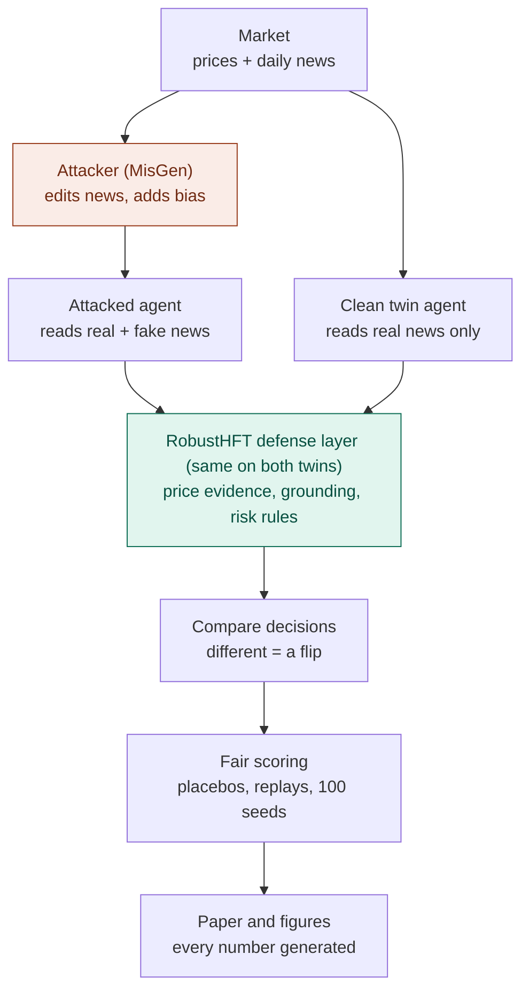

# RobustHFT-AgentLab

**A defense layer against misinformation attacks on LLM-based trading agents, and an offline framework that measures it fairly.**

An AI trading agent reads the news to decide Buy, Sell or Hold. An attacker who slips subtly edited news into what it reads can change its trades. RobustHFT-AgentLab checks the news against what the market's own prices say, and measures how much that protects the agent: with placebo controls, replayed attacks and paired statistics over 100 simulated markets.

B.Tech Project, Department of Computer Science and Engineering, Netaji Subhas University of Technology, New Delhi. Built on *AutoRedTrader* (Liu et al., 2026, arXiv:2605.09185).

> **Safety boundary.** Everything here is a closed, offline simulation: no broker, no order routing, no live trading, nothing published. Generated misinformation is synthetic, is about a fictional company, never leaves the simulator, and every generated record carries `provenance="synthetic"` plus a safety label. Nothing here is investment advice.

## Contents

1. [The project in plain words](#the-project-in-plain-words)
2. [Quick start](#quick-start)
3. [Running with a local LLM](#running-with-a-local-llm)
4. [Real prices (BTC-USD)](#real-prices-btc-usd)
5. [Experiment design](#experiment-design)
6. [Repository layout](#repository-layout)
7. [Development](#development)
8. [Animated showcase](#animated-showcase)
9. [Troubleshooting](#troubleshooting)
10. [Citation](#citation)

---

## The project in plain words

### The idea

LLM trading agents trade on the news they read. Fake news can trick them, and simply detecting fake news is hard. The attacker can change what the agent *reads*, but not what the market *does*. So the defense checks every piece of news against the price evidence and trusts the news less when the two disagree. The second half of the project is measuring that fairly, because a naive measurement overstates how much of an attack is really the misinformation.

### The pipeline



1. **Market.** Each *seed* is one simulated market: 400 days of prices (bull, sideways and bear moods with changing volatility) and 5 news articles a day about a made-up company, *Nordwind Systems*. Good news tends to come before up-days (correlation 0.35), as with real news. The last 60 days are the test period. A second setting uses **real Bitcoin prices** (each seed is a different 400-day stretch of real history) with the same kind of made-up news.
2. **The agent.** Every day it retrieves the 4 most relevant recent articles and rates each as positive or negative. It averages those ratings into a *news signal*, mixes it 75/25 with a quick look at prices, and trades when the signal is strong enough; otherwise it holds. The articles are rated by a finance word list (fast and transparent), or by a **real LLM running locally** (`qwen2.5:7b`, *reader mode*). In *decider mode* the LLM makes the whole Buy/Sell/Hold decision itself.
3. **The attacker (MisGen, from AutoRedTrader).** Every day it makes subtly edited copies of the real articles: "rose" becomes "fell", a number changes, the cause is swapped, or the style is rewritten. It keeps only fakes that read like the original and pass a fake-news detector. It also whispers a *bias* to the agent ("be overconfident", "fear losses") and learns which tricks work.
4. **The twins.** Two identical agents trade the same market. One reads real plus fake news; the *clean twin* reads only real news. A day on which they decide differently is a **flip**, and the share of flipped days is the **attack success rate (ASR)**.
5. **The defense layer (the contribution).**
   - **Price evidence:** what do prices say now (momentum, trend, volatility, trading-activity features)? Plus a history check: the 5 past periods most like today, and what happened next. Only periods whose outcome was already known may be used, so nothing peeks at the future.
   - **Grounding:** news that disagrees with the price evidence is trusted less (its signal is pulled toward the evidence); news that agrees passes untouched.
   - **Risk rules:** a confidence check, position sizing and stop-loss.
6. **Fair scoring.** This is why the numbers can be trusted.
   - **Placebo:** inject harmless paraphrases instead of fake news. Decisions still flip on about 21% of days just because the news pool changed, so we report **net ASR** = attack ASR − placebo ASR.
   - **Frozen replay:** record one attack and replay exactly the same fake articles against every defense, so every defense faces an identical attack.
   - **Statistics:** all variants share the same random numbers, results are averaged over 100 different markets, and a result counts only if its 95% confidence interval excludes zero and its multiple-testing-corrected p-value is below 0.05.
   - **No-peeking tests:** change future prices or news, and check that earlier decisions stay bit-identical.
7. **Paper.** Every number, table and figure in the paper is produced by a script from fixed seeds; nothing is typed by hand.

### What we found so far (100 simulated markets)

| Defense | Net ASR (flips caused by the misinformation) | Return in a clean market |
|---|---|---|
| None | 18.4% | 6.6% |
| **Temporal grounding** | **7.4%** (−11.0 points, 95% CI [9.1, 12.9]) | 2.9% |
| Grounding + risk layer | 9.3% | 2.2% |
| Ignore the news entirely | 0% (cannot be attacked) | −0.3% |
| Fake-news detector filter, 10% / 25% false alarms | 16.5% / 15.5% | 6.0% / 5.9% |
| Median of the article ratings | 12.4% | 6.7% |

- Without a defense the attack flips 39% of days, but 21 points of that also happen with harmless paraphrases. The misinformation itself causes about 18%.
- Grounding cuts that by 60% and beats every standard defense by 5–9 points (all statistically clear). It costs about 3.6 points of return in a clean market.
- The detector filter caught **0%** of the attacker's fakes at its normal setting, because the attacker already screens its fakes against that detector. At a stricter setting it caught 13% and threw away 25% of the real news.
- Microstructure features add nothing detectable on synthetic data, and the hold-on-conflict rule backfires (+1.9 points): the attacker creates the conflict that triggers it. **Shrinking** the trade by the consistency score instead of holding removes the penalty (net ASR 9.3% → 7.5%).
- **The result generalizes.** Grounding's gain holds in every setting we tried:

  | Setting | Markets | Net ASR: none → grounded | Reduction (95% CI) |
  |---|---|---|---|
  | Local LLM (qwen2.5:7b) rates the news | 30 | 14.6% → 7.4% | 7.2 points [3.8, 10.7] |
  | Real BTC-USD prices (2014–2026) | 67 | 16.1% → 7.8% | 8.3 points [6.2, 10.2] |
  | Attacker aligns its fakes with the market | 100 | 19.0% → 7.9% | 11.2 points [8.9, 13.4] |
  | Fake news also moves prices (γ = 2, frozen) | 100 | 17.0% → 6.5% | 10.5 points [8.8, 12.1] |

- **Open problem.** An attacker that picks, among its fakes, the one most at odds with the market raises net ASR against the full layer by 5.6 points [4.1, 7.2].
- **Not run at scale:** the LLM-decider mode (the LLM picks Buy/Sell/Hold itself), which needs about 20 hours for 10 markets on a laptop (command under [Running with a local LLM](#running-with-a-local-llm)), and the conflict-seeking attacker against no defense and grounding alone.

---

## Quick start

```bash
make install            # .venv + requirements + editable install (nothing global)
make data               # data/sample/{prices,news}.csv (synthetic, for data.source=csv)
make train-detector     # outputs/models/detector.pkl (the detectability proxy)
make test               # full test suite (about a minute)

make pipeline           # 18 arms x 100 seeds (~20 min) -> outputs/pipeline/
make ablation           # every ablation group (~4-5 h)  -> outputs/ablation/<group>/
make price-impact       # fake news that also moves prices (~1 h) -> outputs/price_impact/
make report             # outputs/report.md, paper/tables/*.tex, paper/figures/*.pdf
make paper              # paper/main.pdf (tectonic, or pdflatex + bibtex)
```

`make all` runs the whole chain. Every target uses `.venv/bin/python`. Quick runs: `--seeds 2` on any script, or `--seeds 30` for a fast but meaningful run. Without `make`:

```bash
python3 -m venv .venv && source .venv/bin/activate
pip install -r requirements.txt && pip install -e .
python scripts/run_pipeline.py --seeds 2          # logs one line per arm, e.g.
# INFO pipeline: seed=42 injected__none   MER=0.692 lift=1.41 ASR=0.417 CR=+0.171 DD=-0.043
```

Results are reproducible: the same config and seed give bit-identical metrics on every run.

---

## Running with a local LLM

The LLM runs on this machine through [Ollama](https://ollama.com), installed **inside `.venv`**: binary, models and server state all live under `.venv/ollama/`. Nothing is installed globally and nothing touches `~/.ollama`.

```bash
make llm-setup          # pinned Ollama release, checksum-verified -> .venv/bin/ollama
make llm-up             # server on 127.0.0.1:11434 (pid and log in .venv/ollama/)
make llm-pull           # qwen2.5:7b (4.7 GB) and llama3.2:3b (2.0 GB) -> .venv/ollama/models

# reader mode: the LLM rates each article; the defense layer runs exactly as published
python scripts/run_pipeline.py --seeds 30 --out outputs/llm/reader_qwen7b \
    --set llm.provider=ollama --set llm.model=qwen2.5:7b --set agent.text_scorer=llm

# decider mode: the LLM picks Buy/Sell/Hold, with the market evidence in its prompt
python scripts/run_pipeline.py --seeds 10 --out outputs/llm/decider_qwen7b \
    --arms clean,injected,placebo,frozen --levels none,grounded,grounded_risk \
    --set llm.provider=ollama --set llm.model=qwen2.5:7b --set agent.mode=llm \
    --set experiment.counterfactual_asr=false

make llm-down           # stop the server
```

- **Local only.** The client accepts loopback hosts only, so prompts (which contain the synthetic misinformation) never leave the machine.
- **Reproducible.** Decoding is greedy with a fixed seed, answers are constrained to a JSON schema, and every answer is cached in `outputs/llm_cache/`, keyed by everything that can change it. Re-runs are free and exact.
- **Loud failures.** A stopped server, a model that has not been pulled, or an unknown provider raises an error instead of silently degrading to Hold. Unreadable answers are counted; each run writes `llm_stats.json` with the model digest, cache hits and parse failures.
- **Speed** on an Apple M2 with 16 GB: about 2 s per article in reader mode (30 markets in about 8 hours) and 10-15 s per decision in decider mode (10 markets in about 20 hours, so it has not been run at scale). Run one LLM experiment at a time, with nothing else heavy alongside.
- **API models** (`anthropic` or OpenAI-compatible) work the same way, with keys only in `.env` (see `.env.example`).

---

## Real prices (BTC-USD)

```bash
make real-data          # yfinance (in .venv), once -> data/real/btc_usd.csv (git-ignored)
python scripts/run_pipeline.py --seeds 67 --out outputs/real_btc \
    --set data.source=real --set grounding.analog_scale=auto
```

- Each seed uses its own 400-day window of real history. BTC-USD from 2014 to 2026 gives 67 windows whose 60-day test periods never overlap.
- The news is template news about the fictional company, generated per seed and tied to the real next-day returns, so no text about a real asset is ever generated.
- `grounding.analog_scale: auto` rescales the history check to the asset's typical move, using prices from before the test period only.
- yfinance is the project's only network path for data, and it is used once to download prices. Everything downstream reads the saved CSV offline.

---

## Experiment design

**Arms.** Each arm is a paired run: an attacked agent against a clean twin on the same market.

| Arm | What the attacked agent reads | Context |
|---|---|---|
| `clean__*` | real news only | unbiased |
| `placebo__*` | real news + harmless paraphrases of every article | unbiased |
| `injected__*` | real news + MisGen fakes, **adaptive** (the attacker learns against this agent) | attacker's bias prompt |
| `frozen__*` | real news + the attack recorded against the undefended agent, **replayed verbatim** | recorded bias prompts |
| `placebo_matched__*` | real news + paraphrases of only the articles the recorded attack edited | unbiased |
| `placebo_bias__*` | as `placebo_matched__*` | recorded bias prompts |

**Defense levels:**
- `none`: a text-heavy agent with no grounding.
- `grounded`: temporal grounding with microstructure features.
- `grounded_risk`: grounding plus the risk layer.

**Placebo ladder.** The four controls add the attack's ingredients one at a time, so consecutive differences split ASR into four parts:
- retrieval noise;
- article count;
- bias prompts;
- the misinformation's content, i.e. ASR(`frozen`) − ASR(`placebo_bias`).

**Common random numbers.** The attacker is seeded by injection type, never by arm name, and draws from streams keyed by (day, article). Every arm of a seed therefore shares its random numbers. `frozen__none` must reproduce `injected__none` exactly; the pipeline checks this on every seed.

**One-step counterfactual ASR** (`ASR_cf`). Each day a throw-away agent decides with the clean twin's memory and portfolio but the attacked pool and bias. This removes flips caused by drift between the twins. It reads copies only, so it changes no other result (tested).

**Statistics.** Claims are paired per-seed differences, each with:
- a 95% percentile-bootstrap CI;
- a sign-flip permutation p-value;
- Holm correction within each family of related comparisons.

New comparisons always go into new families, so existing p-values never move (`scripts/make_report_tables.py`).

**Metrics:**
- MER (share of retrieved documents that are fake) and MER lift;
- ASR, net ASR, active ASR and counterfactual ASR;
- **position gap**: how far the attack moved the position, not just the decision label;
- clean-market return, attacked-vs-twin return gap, drawdown, Sharpe-like ratio;
- detector recall and real-news loss, for the filter baseline;
- LLM parse-failure rate.

**Ablation groups** (`configs/ablation.yaml`, `make ablation` or `--group <name>`):

| Group | Question | Variants |
|---|---|---|
| `attack` | Which attack components matter? | full; without filtering, feedback, bias, minor edits or rewriting |
| `defense` | Which defense components matter? | none, price-only grounding, + microstructure, risk only, full, without hold-on-conflict |
| `retrieval` | Is net ASR an artifact of top-k? | k = 2, 4, 8 |
| `grounding_strength` | How strong should grounding be? | κ = 0.3, 0.7, 1.0 |
| `baselines` | Does grounding beat standard defenses? | text-free agent, detector filter at 10% and 25% false alarms, median and trimmed-mean pooling |
| `aware_attack` | What if the attacker knows the defense? | evidence-aligned and conflict-seeking attackers against none, grounding and the full layer |
| `conflict_handling` | Can the hold-on-conflict backfire be fixed? | hold, shrink, no rule; against the standard and the conflict-seeking attacker |

**Price impact** (`make price-impact`). The recorded attack also moves the shared price path, by γ daily standard deviations per unit of sentiment shift (γ = 0, 1, 2). Both twins trade the moved prices; only the attacked agent reads the fake text.

**Replications.** The headline comparisons are repeated with the local-LLM reader and real BTC-USD prices (and with the LLM decider once its run exists). Each is listed in `REPLICATIONS` in `scripts/make_report_tables.py` and has its own families.

---

## Repository layout

```
configs/            default.yaml (every knob), ablation.yaml (ablation groups)
src/rhal/           the package
  config.py           pydantic Config; unknown keys are an error; LLM settings only from .env / --set
  seeding.py          keyed random streams: paired comparisons stay paired
  lexicon.py          single source of finance vocabulary (generator, scorer, operators, detector)
  schemas.py          NewsItem (mandatory provenance), Decision, MarketEvidence, BiasConfig
  data/               synthetic prices + template news, real-price loader and validation
  features/           trailing features and microstructure proxies (no lookahead)
  grounding/          historical analogs (e + H <= t) and the market-evidence model
  memory/             date-gated news pool, TF-IDF/BM25 retrieval, optional detector filter
  misgen/             attack operators, Polya-urn sampler, detector, filters, engine (incl. defense-aware attacker)
  agent/              sentiment, perception, profile, memory, policies, LLM reader, risk layer
  llm/                provider clients with a disk cache: mock, Ollama (local), Anthropic, OpenAI-compatible
  backtest/           accounting with fees, slippage and next-open execution
  evaluation/         paired Simulation, metrics, statistics, price impact, report helpers
scripts/            run_pipeline, run_ablation, run_price_impact, make_report_tables, make_paper_figures,
                    export_frontend_data, train_detector, generate_sample_data, fetch_real_prices, setup_ollama.sh
tests/              pytest suite: no-lookahead mutation tests, determinism, CRN, controls, LLM client, baselines
paper/              conference manuscript (paper/README.md); tables/ and figures/*.pdf are GENERATED
docs/               ARCHITECTURE.md (diagrams, class design), GLOSSARY.md (terms), ROADMAP.md (status and plan)
reports/midterm/    mid-term BTP report
frontend/           animated offline showcase (data.js is GENERATED by `make frontend`)
data/               sample/ and real/ CSVs (git-ignored; written by `make data` and `make real-data`)
outputs/            every run artifact (git-ignored; regenerate with the make targets)
```

---

## Development

```bash
make test               # full suite;  make test-fast stops at the first failure
make lint               # ruff format --check + ruff check (config in pyproject.toml)
make format             # ruff format + safe autofixes
```

- **Determinism:** two runs with the same config and seed give identical metrics. Randomness goes only through `rhal.seeding.rng`.
- **No lookahead:** decisions at day t may use only rows up to t. Tests mutate future prices and future article text, and require earlier decisions to stay bit-identical.
- **Generated artifacts:** paper tables, figures and macros, and `frontend/data.js`, are written by scripts. Never edit them by hand.
- **Conventions for contributors and AI assistants:** see `CLAUDE.md`.

---

## Animated showcase

`frontend/index.html` is a self-contained, animated walkthrough for demos and the viva. It works offline, uses no external libraries or fonts, and supports light and dark themes and reduced motion. It has three parts:
- an animated trading day;
- two synchronised "with vs without" panels replaying the same 60 days (attack, placebo, grounding, risk layer);
- the results, with confidence intervals.

```bash
make frontend                                    # writes frontend/data.js from a seed-42 replay + the latest outputs/
python -m http.server 8765 --directory frontend  # then open http://localhost:8765
```

The page shows only *labels* of generated documents (edit type, rewrite style), never their text.

---

## Troubleshooting

- **`ModuleNotFoundError: rhal`**: run `pip install -e .` inside the venv, or run scripts from the repo root (they add `src/` to the path).
- **`not enough history`**: `data.n_days − data.eval_days` must be at least 100.
- **A config key is rejected**: config sections forbid unknown keys, so check the spelling against `configs/default.yaml`.
- **`cannot reach Ollama`**: run `make llm-up`. **`model ... is not available`**: run `make llm-pull LLM_MODELS=<tag>`.
- **Slow LLM runs**: close memory-hungry apps (16 GB machines swap with a 7B model loaded), and run one LLM experiment at a time.
- **`retrieval.method=embed` fails**: it needs `pip install -e '.[embed]'` and downloads a model from Hugging Face. It is not part of the offline setup.
- **Numbers differ from the paper**: check `seed`, `configs/default.yaml`, and that `outputs/models/detector.pkl` was trained with the same seed (delete it to retrain).

---

## Citation

Base paper: Liu, Z., Yu, Y., Cao, Y., et al. *AutoRedTrader: Autonomous Red Teaming of Trading Agents through Synthetic Misinformation Injection.* arXiv:2605.09185, 2026.

This project: Agarwal, A., Habib, A., Kumar, A. *RobustHFT-AgentLab: A Defense Layer Against Misinformation Attacks on LLM-Based Trading Agents.* B.Tech Project, NSUT, 2026 (manuscript in `paper/`).
