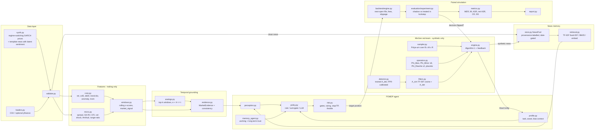
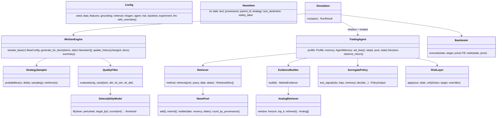
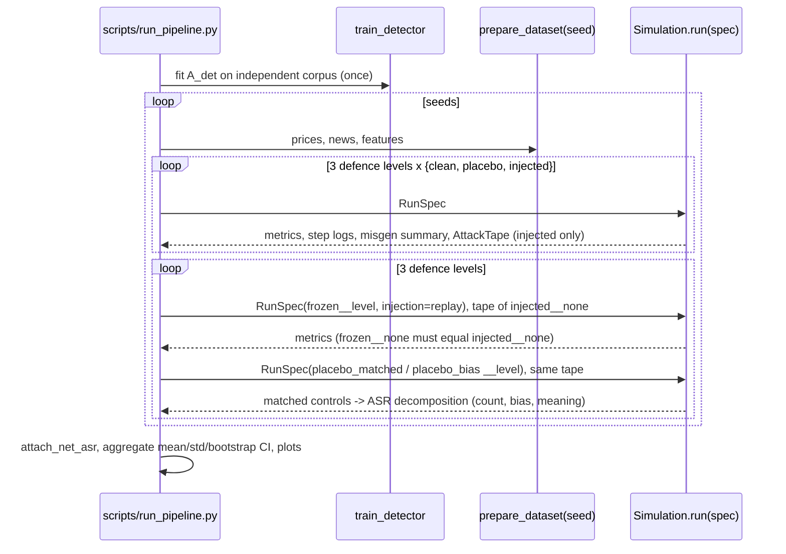

# Architecture

RobustHFT-AgentLab reproduces the closed-loop red-teaming setting of AutoRedTrader and extends it with stronger temporal evidence, an explicit risk layer, strict no-lookahead verification and a placebo-controlled attack metric. This document gives the system diagram, module design, data flow, class design, experiment flow, and the safety boundary.

## 1. System diagram



## 2. Module-level design

| Module | Responsibility | Paper origin | Our extension / simplification |
|---|---|---|---|
| `data.synth` | Deterministic OHLCV (3-regime Markov drift, GARCH(1,1) vol) and news whose latent sentiment is ρ-correlated with the next-day return; optional Brownian-bridge minute bars | Paper uses real BTC data + Alpaca news | **Simplification**: synthetic data so the project is offline and reproducible; real CSV/yfinance supported |
| `features.core` | price, return, 5-day vol, 20-day drawdown, trend divergence, residual anomaly | Eq. 19 | Anomaly = trailing-z residual instead of STL (STL is not online-safe) |
| `features.micro` | HFT-inspired proxies from OHLCV or intraday buy/sell volume | — | **Extension** |
| `features.windows` | trailing z-scores, fixed-weight bounded market signal | "normalised windows" | Fixed weights (no fitting ⇒ no leakage) |
| `grounding.analogs` | cosine top-k over flattened 30-day windows; admissible iff `e+H ≤ t` | "historical analogs and outcomes" | **Extension**: strict admissibility; paper does not state it |
| `grounding.evidence` | evidence blends market signal with analog forward returns; consistency `c = 1 − |s_text − s_mkt|/2` | "consistency assessment" | Explicit formula |
| `memory` | date-gated pool with provenance; TF-IDF with IDF fit once on a background corpus | FAISS layered memory | **Simplification**: no FAISS; fixed IDF mimics a frozen embedder |
| `misgen.operators` | deterministic operators for all 5 biases, 8 minor types, 2 rewrite styles, and a placebo | App. E prompts | **Simplification**: rule-based stand-ins for LLM prompts; **extension**: placebo |
| `misgen.sampler` | `w = 1 + αh`, categorical sampling, return-dependent δ | §2.2.3 Eqs. 16–18 | verbatim |
| `misgen.detector` | logistic regression on 18 interpretable cues, threshold at target clean-FPR | LLM detectability evaluator | **Simplification**; trained only on Φ_Minor outputs so Φ_Rewrite can launder |
| `misgen.engine` | Algorithm 1 with `max_tries`, feedback update (Eq. 7) | App. E.1 | verbatim structure |
| `agent.*` | Perception / Profile / Memory / Action, three policy modes | InvestorBench/FinMem agent | Surrogate policy with bias operationalised numerically |
| `agent.risk` | confidence gate, hold-on-conflict, vol-target sizing, stop/TP, drawdown throttle | — | **Extension** |
| `backtest` | next-open execution, bps fees + slippage, no leverage, long-only default | "cumulative return" | Explicit accounting invariants |
| `evaluation` | paired simulation, MER / MER lift / ASR / net ASR, ablations | Eqs. 8–9, Table 2 | **Extension**: lift, net ASR, defence ablations |

## 3. Data flow for one trading day `t`

1. **MisGen** (treated arm only): sample day-level bias `b_t` with prob `p` → `BiasConfig` into the treated agent's Profile. For every clean item dated `t`: sample `m` → `Minor`; evaluate `(A_sim, A_det)`; if rejected and `A_sim` ok, sample `r` → `Rewrite`; re-evaluate; accept into the treated pool with `provenance="synthetic"`.
2. **Mark** both portfolios at `close_t`.
3. **Perceive**: both agents build the retrieval query from Profile (+ evidence state), retrieve top-k from their own pool restricted to dates `≤ t` within `recency_days`; grounded agents additionally build `MarketEvidence(t)`.
4. **Decide**: policy → `PolicyOutput(action, confidence, signals, consistency)`; risk layer → `(action, target_position, overrides)`.
5. **Execute** at `open_{t+1}` with slippage and fees; mark at `close_{t+1}`; reflect (memory gets the realised asset return).
6. **Feedback**: if `action_treated ≠ action_shadow`, reinforce the bias and the strategies of every synthetic doc that was retrieved (Eq. 7).

Nothing in steps 3–4 reads any row `> t`; step 5 reads `t+1` only for execution and marking.

## 4. Class design



## 5. Experiment flow



`run_ablation.py` repeats the loop with dotted overrides per variant (the defence and κ groups also replay the frozen tape); `make_report_tables.py` collects everything into `outputs/report.md`, `paper/tables/*.tex` and `paper/figures/`, and runs the paired comparisons of `evaluation/stats.py` (bootstrap CI, sign-flip permutation test, Holm correction per family).

**One-step counterfactual.** Inside every run a third agent decides each day with deep copies of the shadow's memory and portfolio plus the treated pool and bias (`cf_action` → `ASR_cf`). It never writes back, so the shadow/treated trajectories are untouched.

**Randomness.** Each component draws from `rhal.seeding.rng(master, *tags)`. MisGen is seeded by (seed, injection type) and uses one stream per (day, item), so all arms of a seed share the attacker's random numbers; an arm's name never enters a seed.

## 6. The surrogate agent (mock-LLM) in equations

Text signal from retrieved docs `D` with retrieval weights `w_j` and lexicon sentiment `σ(d_j)`:

```
s_text = Σ_j w̃_j σ(d_j),   w̃ ∝ w · (1 + confirm · 1[sign σ(d_j) = sign a_{t-1}])
loss aversion:  s_text ← downside · s_text  if s_text < 0
anchoring:      s_text ← (1−a) s_text + a s_text,t−1
herding:        s_text ← s_text + h · sign(Σ recent actions)
```
Fusion and grounding (κ = `grounding.strength`, `c` = consistency):
```
s = λ s_text + (1−λ) s_mkt                      (λ = agent.text_weight)
s_g = s − κ (1 − c) (s − s_mkt)                  (grounded only)
action = Buy if s > θ·τ_b, Sell if s < −θ·τ_b, else Hold   (τ_b = bias threshold scale)
```
Grounding therefore leaves consistent text alone and shrinks inconsistent text toward market evidence — the hypothesis is that this reduces ASR more than it reduces clean return.

## 7. Safety boundaries

* **Simulation-only**: no `broker`, `order`, or `execute-live` code path exists; `Backtester.execute` mutates an in-memory `PortfolioState` only.
* **Provenance is mandatory**: `NewsItem.provenance ∈ {clean, synthetic, placebo}`; `safety_label` is validated non-empty; retrieval returns labels; metrics are computed from labels.
* **Synthetic text never leaves the process** except into `outputs/` step logs, which are explicitly labelled and git-ignored.
* **No directional attack objective**: MisGen maximises decision change, not profit for the attacker; there is no code to steer prices.
* **Keys**: read only from `.env`; YAML cannot carry them; the mock provider is the default.

## 8. Provenance of ideas

* **From the paper**: closed-loop MisGen; bias/minor/rewrite decomposition; similarity + detectability filtering; Pólya-urn history-aware sampling with return-dependent bias boost; clean vs injected comparison; MER, ASR, CR; POMDP agent with Perception/Profile/Memory/Action; time-series-informed grounding with 30-day windows and analog outcomes; ablations w/o filtering/feedback/bias/minor/rewrite.
* **Our extensions**: microstructure proxies as grounding evidence; explicit risk layer; strict analog admissibility (`e+H ≤ t`); trailing-only normalisation with mutation tests; paired shadow/treated simulation; placebo arm and net ASR; MER lift; defence-side ablations and the robustness–return frontier; retrieval-breadth and κ sweeps; adaptive text-trust memory (off by default); reproducible LLM response cache.
* **Implementation simplifications**: synthetic data and template news; rule-based operators instead of LLM prompts; feature-based detector instead of an LLM judge; fixed-weight market signal; residual-z anomaly instead of STL; daily-close stop-loss checks; no FAISS.
